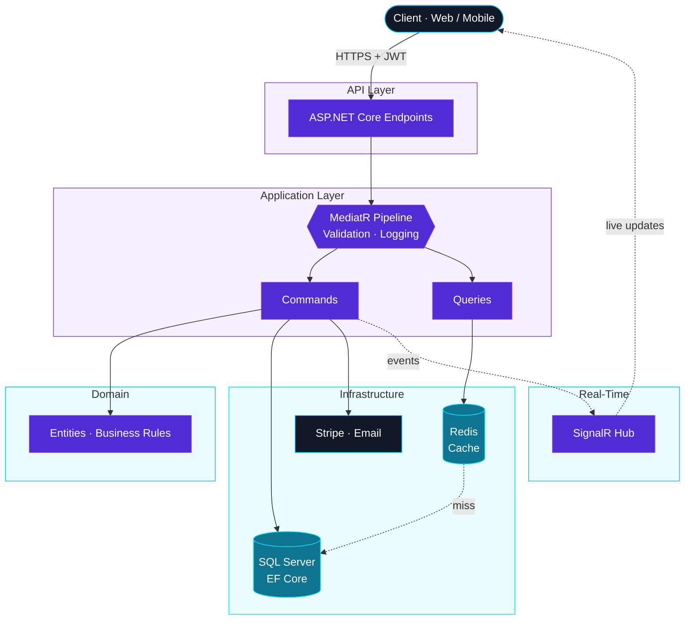

 

## How I Build a Backend

## Featured Projects

<table>
<tr>
<td width="50%" valign="top">

### [TimeTable](https://github.com/HossamTohamy1/Time-Mangments)

**Configuration-driven school & university timetabling — bilingual AR / EN.**

Generates timetables with the OR-Tools CP-SAT solver, pushes live changes over SignalR, and exports to PDF & Excel. Every institution type is data, not code.

</td>
<td width="50%" valign="top">

### [Tracking](https://github.com/HossamTohamy1/Tracking)

**Import & shipment tracking platform.**

Customers request an import, get the full cost calculated (shipping, customs, fees), pay by card, and follow their container stage by stage. Ships with a [React 19 PWA client](https://github.com/HossamTohamy1/Front_Tracking).

</td>
</tr>
<tr>
<td width="50%" valign="top">

### [Loma — AuraCommerce](https://github.com/HossamTohamy1/Loma)

**Online store API with a built-in theme customizer.**

Products, categories, cart and orders, plus a no-code store designer. Tuned with in-memory caching and Brotli / Gzip compression; serves its Angular build from `wwwroot`.

</td>
<td width="50%" valign="top">

### [Hotel System](https://github.com/HossamTohamy1/Hotel_System)

**Hotel operations back-end.**

Rooms & facilities, multi-room reservations, offers, payments and reviews — with role- and feature-based permissions so every employee can do exactly what they should.

</td>
</tr>
</table>

<b>More projects</b>

 

| Project | What it is | Stack |
| :-- | :-- | :-- |
| [School](https://github.com/HossamTohamy1/School) | School management API with paged results | .NET 9 · CQRS · MediatR · FluentValidation |
| [Examination System](https://github.com/HossamTohamy1/ExaminationSystem) | Online exams with automatic grading | .NET 9 · ASP.NET Core Identity · Repository pattern |
| [Hospital](https://github.com/HossamTohamy1/Hosptial) | Patients, diagnoses & prescriptions web app | ASP.NET Core MVC · Identity · SMTP |
| [Tourism System](https://github.com/HossamTohamy1/Tourism_System) | Tourism booking API with online payments | Node.js · Express · MongoDB · Stripe |
| [Front Tracking](https://github.com/HossamTohamy1/Front_Tracking) | Client app for the Tracking platform | React 19 · TypeScript · Vite · PWA |
| [Classes Management](https://github.com/HossamTohamy1/Classes_Managment) | Class management dashboard | Angular 20 · Angular Material |

## Tech Stack

<table>
<tr>
<td align="center" width="130"><b>Back-End</b></td>
<td> <code>C#</code> <code>ASP.NET Core</code> <code>Web API</code> <code>MVC</code> <code>EF Core</code> <code>LINQ</code> <code>SignalR</code></td>
</tr>
<tr>
<td align="center"><b>Libraries</b></td>
<td><code>MediatR</code> <code>FluentValidation</code> <code>AutoMapper</code> <code>Serilog</code> <code>Identity</code> <code>Swagger</code> <code>QuestPDF</code> <code>OR-Tools</code></td>
</tr>
<tr>
<td align="center"><b>Data</b></td>
<td> <code>SQL Server</code> <code>PostgreSQL</code> <code>MongoDB</code> <code>Redis</code></td>
</tr>
<tr>
<td align="center"><b>Tools</b></td>
<td> <code>Docker</code> <code>Git</code> <code>GitHub</code> <code>Postman</code> <code>Visual Studio</code> <code>Figma</code></td>
</tr>
</table>

<b>Beyond .NET — comfortable crossing the stack when the project needs it</b>

 

`Angular` · `React` · `TypeScript` · `JavaScript` · `Node.js` · `Express` · `Python` · `FastAPI` · `Laravel` · `PHP` · `Flutter`

## Leveling Up

- [x] ASP.NET Core Web API, EF Core & SQL Server
- [x] Clean Architecture + CQRS with MediatR
- [x] JWT, refresh-token rotation, OTP & 2FA
- [x] Real-time apps with SignalR
- [ ] Distributed caching with Redis
- [ ] Messaging & event-driven architecture
- [ ] Containerized, scalable APIs with Docker

`BUILDING` ➜ `LEARNING` ➜ `REFACTORING` ➜ `SCALING`

## Teaching

I teach **Cybersecurity**, **Web Development**, **Data Science & EDA**, **AI** and **Databases**.
`LEARN` ➜ `BUILD` ➜ `SHARE`

## GitHub Analytics

<picture>
  <source media="(prefers-color-scheme: dark)" srcset="https://github-readme-stats.vercel.app/api/top-langs/?username=HossamTohamy1&layout=compact&langs_count=6&hide=html,css,scss,cmake,c%2B%2B,swift&hide_border=true&border_radius=10&card_width=320&bg_color=0D1117&title_color=A78BFA&text_color=C9D1D9"/>
  
</picture>
<picture>
  <source media="(prefers-color-scheme: dark)" srcset="https://streak-stats.demolab.com?user=HossamTohamy1&hide_border=true&border_radius=10&background=0D1117&stroke=30363D&ring=7C3AED&fire=00E5FF&currStreakNum=FFFFFF&sideNums=FFFFFF&currStreakLabel=00E5FF&sideLabels=C9D1D9&dates=8B949E"/>
  
</picture>

<picture>
  <source media="(prefers-color-scheme: dark)" srcset="https://github-profile-summary-cards.vercel.app/api/cards/profile-details?username=HossamTohamy1&theme=github_dark"/>
  
</picture>

### Contribution Snake

<picture>
  <source media="(prefers-color-scheme: dark)" srcset="https://raw.githubusercontent.com/HossamTohamy1/HossamTohamy1/output/github-contribution-grid-snake-dark.svg"/>
  
</picture>

**Outside the code:** Football · Gym · Always learning

<a href="#readme-top">Back to top</a>

